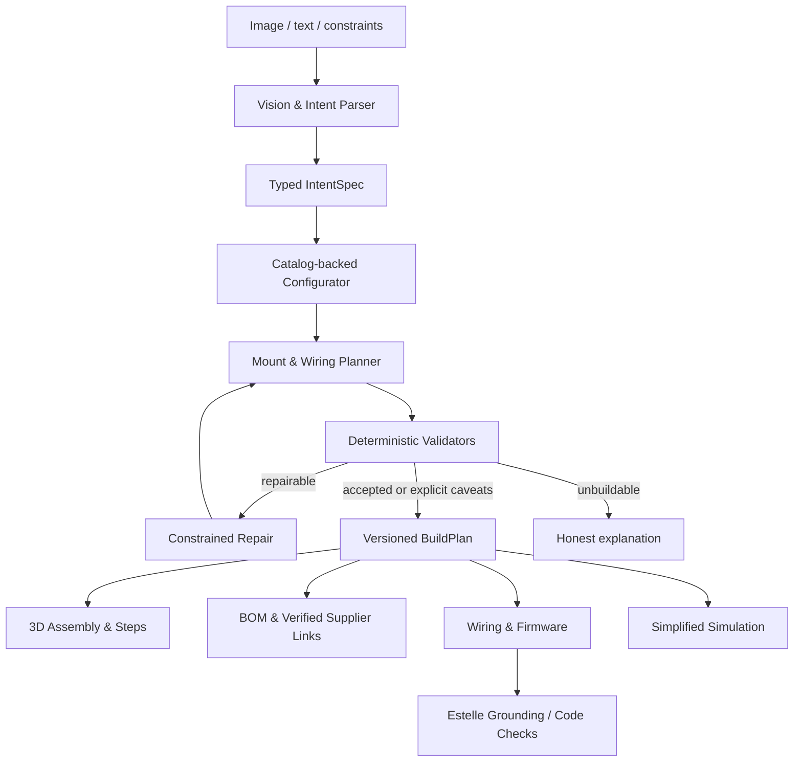

# RIVET — Project Specification

> **Canonical product specification · SOON Hackathon · v1.0 · October 24, 2026**  
> Companion: [`implementation.md`](implementation.md)  
> Status: implementation-ready plan, **not** a claim that features already exist.

## 0. Read this first (for humans and coding agents)

Rivet is an AI-assisted hardware-building platform for software developers, makers, students, and beginners. A user uploads an inspiration image or describes an idea for a robot, RC vehicle, drone, or programmable device. Rivet interprets the requested appearance and behavior, selects **real cataloged components**, creates a **consistent interactive 3D assembly**, validates supported engineering constraints, produces a **part-level bill of materials (BOM) and purchasing links**, and exports wiring, assembly steps, starter firmware, and an honest simulation where supported.

**Any photo can be rendered in 3D.** Every uploaded photo (or description) of a physical object becomes an interactive **3D concept model**: separate, selectable parts made of shaped primitives in the photo's colors and materials, with inferred internal boards and wiring for powered devices (visible with X-ray). Concept models are appearance-only and labeled as such: no real products, prices, engineering checks or firmware.

**The engineered proof is a two-wheel indoor rover.** Only the rover gets real cataloged parts, verification, wiring, simulation and firmware; it is also the fallback when a concept model cannot be built. The team must **not** pretend to fully support flight, arbitrary robotics, or electrical certification. RC-car-style variants are a stretch built on the rover primitives. Other categories can be visualized as concepts but stay *planned* for engineering until implemented and tested.

**Product promise:** From inspiration to an informed, buildable hardware starting point, without spending days researching components, wiring, mechanical fit, and code.

**Source of truth:** This file owns product requirements, capabilities, and language. `implementation.md` owns technical contracts, code ownership, schedule, tests, and launch. If they conflict, keep the shared schema and safety/verification rules in `implementation.md` authoritative for implementation, then reconcile both in a reviewed change.

### Non-negotiable principles

1. **One design, one truth.** The 3D viewer, BOM, pins, assembly instructions, firmware profile, and simulation must all derive from the same versioned `BuildPlan`. No disconnected AI-generated illustration masquerading as geometry.
2. **Real parts, real links.** Every shopping item maps to a component with a stable catalog ID, SKU, manufacturer or vendor, evidence URL, and a verified product link when available. Never invent prices, stock, or supplier links.
3. **AI chooses intentions; deterministic code decides validity.** AI extracts requirements and proposes configurations. The catalog, assembly templates, constraints, and compiler determine placements, compatibility, and supported outputs.
4. **Unknown is not verified.** Missing electrical ratings, mount information, or structural evidence yield `UNKNOWN`/`WARN`/`NEEDS_REVIEW`, not fabricated pass/fail certainty.
5. **The rover works end to end before expanding scope.** One convincing tested workflow beats five unfinished hardware categories.
6. **The 3D interface is a core engineering deliverable.** It must feel precise and delightful even before the external designer finishes visual polish.
7. **Model/integration provenance is visible.** Clearly label generated, inferred, measured, sourced, validated, simulated, and unverified facts.
8. **No unlicensed code reuse.** Do not copy source files, UI assets, proprietary imagery, or code from third-party projects without permission or a verified license. Study published designs; implement original code.

---

## 1. Why Rivet should exist

### The problem

A developer can describe the software a robot should run, but hardware projects require decisions across incompatible information sources: the mechanical layout, motor torque/current, battery and power delivery, controller pin limits, sensor buses, mounting adapters, drivers, firmware libraries, shopping availability, and assembly order. Beginners search tutorials and storefronts, then discover that a recommended component won't fit, lacks suitable documentation, or cannot connect to their chosen electronics.

Generic image-to-3D tools produce meshes, not engineering-ready assemblies. Conversational AI can suggest parts, but suggestions frequently do not share a concrete mechanical and electrical model. Professional electronics/CAD tooling serves a different audience and may require substantial domain expertise.

### Our solution

Rivet starts from a visual reference or prompt and constructs a **component-backed engineering design**. The design can be inspected, modified, verified within explicitly defined boundaries, simulated for supported behavior, and turned into a realistic build plan.

The moment a person clicks on a wheel, motor, sensor, or controller in the viewer, Rivet knows exactly which part it is, why it was selected, what specification evidence was used, how it connects, what it costs if a verified price exists, and how it appears in assembly and firmware.

### Who benefits

| Persona | Pain | First useful Rivet outcome |
|---|---|---|
| Software developer entering robotics | Understands code, not parts/mounting/power | A documented starter design with component-backed 3D layout, safe caveats, and firmware scaffold |
| Student/hackathon builder | Has a concept and limited budget/time | A concrete shopping list, estimated budget, component compatibility report, and build sequence |
| Maker/hobbyist | Wants variations of an existing build | Component substitutions with fit/electrical feedback and updated instructions |
| STEM educator | Needs approachable, repeatable projects | Explainable example builds and transparent checks, rather than opaque AI answers |
| Future: kit supplier/retailer | Needs discoverable compatible bundles | Configurator that points to real SKUs and can produce a sourced kit |

### Why now / business hypothesis

Vision models can interpret reference images; modular 3D components and inexpensive maker ecosystems make constrained hardware design demonstrable. The opportunity is not a claim of being the first AI hardware designer. Rivet focuses on **the continuity from inspiration to purchased parts to code and assembly**, specifically for people learning hardware through projects. Validate demand with interviews and usage data; do not present it as proven traction.

---

## 2. What users can do

### Default journey: any photo → 3D concept model

1. **Upload** a photo of any physical object (drone, vehicle, furniture, appliance, gadget, toy) or describe one, and choose **Generate 3D model**.
2. **Rebuild**: the vision model breaks the object into recognisable parts (body, arms, rotors, wheels, panels, lenses, ...), each a primitive shape with size, pose, color and material. Long thin parts are placed by their two ends; the server grounds and centres the model and sends floating parts back to the model once.
3. **Infer the inside** of powered devices: typical internal parts (for a drone: flight controller, ESCs, power distribution board, receiver) placed inside the body, plus wires between named parts. These are always labeled *inside, inferred*; overlapping boards are stacked so each stays visible.
4. **Explore** in the studio: select parts, exploded view, assembly steps, and **X-ray** to see through the shell to the boards and wiring.
5. **Edit in words** ("make the propellers blue", "add a camera on the front"); each accepted change is a new revision. A request that changes nothing is not applied.
6. **Limits**: works best for one clear object; scenes, several objects, very blurry photos and organic shapes give rough results. Wiring is the typical layout for that kind of device, not the exact product's.

### Engineered journey: image → robot

Chosen with **Check for a real-parts rover build**.

1. **Upload** a JPG/PNG/WebP photo, sketch, reference render, or screenshot. Optional text clarifies intended behavior and constraints. A reference image is a *visual goal*, not an X-ray or dimensioned CAD model.
2. **Interpret** the visible features: approximate body shape, wheel arrangement, sensors/appendages, likely project family, color/stylistic descriptors, and behavior requests. Rivet displays assumptions and missing information.
3. **Choose hardware** from the supported catalog. The initial rover chooses a verified chassis template, motor pair, driver, microcontroller, power architecture, range sensor, mounts, and necessary ancillary items.
4. **Build a coherent 3D assembly** by placing known mesh/procedural parts on defined attachment frames; surface attractive object materials, purposeful camera motion, highlightable components, and optional exploded/timeline views.
5. **Run checks** on dimensional placement, supported connectors, controller pins, logic voltages, motor driver ratings, known motor-voltage ranges, power source requirements, approximate mass/clearance, price cap, and unsupported claims.
6. **Repair or explain** if a constraint fails: switch to a validated alternative, adjust a compatible mount/layout, remove an optional feature only with user-visible notice, or return `needs_review/unbuildable`. No silent compromise.
7. **Inspect build details**: each instance opens the corresponding catalog item with SKU, datasheet/manufacturer source, price only if checked, supplier URL, quantity, dimensions, wiring interface, and verification notes.
8. **Explore assembly**: timeline reveals subassemblies in a mechanically sensible order; material and electrical connections are differentiated.
9. **Simulate** the supported rover's differential-drive movement and obstacle detection in a simplified virtual environment. Do not claim hardware-equivalent performance, physics certification, autonomous real-world safety, or arbitrary sensor realism.
10. **Export** JSON design, BOM CSV/JSON, human-readable assembly guide, pin-map/wiring file, and a PlatformIO ESP32 project for a supported behavior profile; optional compilation validates code syntax/toolchain compatibility.

### Secondary journey: text → build

Input: “Make a compact indoor rover that can detect walls, uses an ESP32, and stays under a specified budget.” Same engineering pipeline, no image needed. The design UI always allows written revisions: “Make the rover wider,” “Use a different compatible sensor,” or “Can it be cheaper?”

### Editing rules

- Engineered builds: edits are declarative operations on the design intent or a typed configuration field, not arbitrary LLM mesh manipulation.
- Concept models: edits are plain-language requests applied by the vision model to the concept's parts and wires; the result is rebuilt and checked by code like a new concept.
- Each accepted edit creates a new immutable revision. Preserve previous revisions and allow undo/redo.
- Recompute and recheck **all affected** BOM, geometry, power, pin mapping, firmware configuration and simulation metadata.
- A rejected edit leaves the last good design unchanged and explains the issue.
- Where a user requests unsupported behavior (flight, articulated manipulator, outdoor autonomy, human following using only a distance sensor), state the missing capabilities clearly.

---

## 3. The visual experience

The design experience is Rivet's primary consumer differentiation. The designer is a **separate fourth contributor** who owns final styling, interaction polish, marketing/presentation UI, typography, colors, visual identity, responsiveness and motion system. Three developers own working engineering systems; one of those developers owns the functional 3D subsystem. Developers may build clean, neutral scaffolding. The designer integrates visual polish without rewriting the domain contract.

### Home / starting point

- Hero: large animated 3D reference project or tasteful embedded scene.
- Two starts: **Upload inspiration** and **Describe a build**.
- Examples: “Obstacle-avoiding rover”, “Mini RC car”, with status labels such as *supported*, *limited*, *coming later*.
- Clarify that an image is interpreted into a new supported build, not reverse-engineered with certainty.

### Studio / core layout

- **Left:** prompt, original image thumbnail, visual requirements, constraints (budget, size, supported behavior), change history.
- **Center:** high-quality WebGL studio showing coherent part geometry. Orbit, zoom, pan, fit, isolate, component selection, exploded assembly, step scrub, hide/wireframe, mounting and electrical overlays.
- **Right:** contextual inspector containing selected real component data, exact purchasing links, matching BOM row, quality/evidence state, and assembly step references.
- **Bottom:** action modes: Design, Inspect, Wiring, Assemble, Simulate. Running the simulator must use the same design version.

### Essential 3D interactions

1. Large framed model at useful angle; soft shadows, curated lighting, no noisy default debug-grid look.
2. Click a wheel → wheel mesh highlight + hardware BOM details + attachment location.
3. Explode → chassis, wheels, electronics and sensors separate along controlled axes, then reconverge.
4. Scroll/timeline → assemble the hardware in defined steps, ghost forthcoming parts.
5. Inspect wiring → colored wire paths/ports and pin labels aligned to components.
6. Edit behavior/components → animated, **actual** change to parts and view; if model cannot regenerate, explicit error.
7. Simulate → separate scene using the same parameters and behavior profile, with obvious “Simplified simulation” label.
8. Screenshots/export → deterministic camera framing and stable visible output.

### Visualization quality bar

- Distinct material types (matte polymer chassis, rubber tires, metallic fasteners, green/black PCB, sensor glass).
- Readable silhouette in the first screen; avoid thumbnail-sized robots.
- Smooth 60 fps target on a current laptop for a ~20–35-part rover; degrade gracefully.
- No external 3D generator is treated as a certified geometry source.
- Real component dimensions and relative placements drive proportions. Procedural meshes may approximate appearance but must be labeled as visual representations.
- A minimum of **one WebGL canvas** for the active studio where practical; static cards use images/screenshots to avoid costly parallel contexts.

---

## 4. Hackathon scope: promise vs proof

| Capability | Hackathon guarantee target | Later |
|---|---|---|
| Input | Image upload + text instruction | Video/multi-image dimension inference |
| Any object (concept) | Any photo or description rendered as a labeled 3D concept model: shaped parts, inferred internals and wiring, X-ray, plain-language edits | Mesh-level image-to-3D detail (e.g. an image-to-3D service as an optional reference shell) |
| Engineered product family | Supported differential-drive indoor rover | Robotic arms, RC cars, drones, IoT |
| Visual design | Component-backed interactive 3D (rover) or shaped-primitive concept 3D (any object) + exploded assembly + part selection | Arbitrary CAD/manufacturing |
| Mechanical checks | Template-defined mounts, dimensions, basic AABB collision/clearance for supported parts | Full rigid-body stress/structural analysis |
| Electrical checks | Curated controller, drivers, sensors, pin allocations, documented voltage/current checks | Circuit design, EMC, thermal modeling and electrical certification |
| AI pipeline | Requirement extraction and constrained proposal | Broad hardware design search/autonomous CAD |
| BOM | All required parts, exact catalog IDs, manufacturer references and verified links where available | Live inventory and checkout integrations |
| Assembly | Step-by-step visual plan + material/wiring notes | AR and arbitrary physical assembly reasoning |
| Firmware | Generated from supported ESP32 behavior templates, with optional compile checks | Arbitrary firmware/controller generation |
| Simulation | Simple 2D differential-drive rover and range sensor behavior | Full fidelity robotics simulation |
| Estelle | Meaningful source-grounded firmware modification/evidence when service available | Long-term project memory across users |
| Hardware demo | Optional prepared physical rover | Manufactured user-requested devices |

**Scope discipline:** Category labels must represent actual capability. A drone (or any other object) may be shown as a **3D concept model**, always labeled *Concept model · appearance only*, never as a supported, buildable or verified design. *Coming soon* must not invoke a fake full generator.

### Concept demonstration prompt

Upload a photo of a drone and choose **Generate 3D model**, then turn on **X-ray** and ask: **“Make the propellers blue and add a camera on the front.”**

Successful output: a recognisable 3D model of the photographed drone in its colors, made of selectable parts; inferred internals (flight controller, ESCs, power distribution board, receiver) and wiring visible with X-ray and labeled inferred; the edit as revision 2; the concept label everywhere and no prices, links or engineering claims.

### Canonical demonstration prompt

Upload a reference image of a small wheeled robot. Ask: **“Design something like this that can avoid obstacles. Use real parts and explain how to build it.”**

Successful output: matching-looking but not identical supported rover; 3D assembly; stable part selection; source-backed part list; electrical and fit check report; wiring/pin map; compiled or compile-ready firmware; simplified differential-drive obstacle avoidance simulation; truthful estimated total.

### Follow-up demonstration prompt

**“Make it cheaper and move the sensor higher.”**

Successful output: either a supported substitution and a visible sensor placement update (with all relevant checks rerun), or a clear, evidence-backed explanation why the edit cannot be satisfied. A budget is *not* “met” when supplier prices are missing; mark the price result **unknown**.

---

## 5. Product system design

### Domain concepts

**IntentSpec:** What the user wants and what image analysis can defensibly infer. Separate user requirements from uncertain visual guesses and supported category declarations.

**CatalogComponent:** Stable SKU/manufacturer identity, category, dimensions in millimeters, mass if known, visual asset or procedural render recipe, mechanical mounting frames, electrical ports and documented limits, source links, and price evidence with timestamps.

**ComponentInstance:** An occurrence of a catalog component in a build, with a globally unique instance ID, parent connection/mount, rigid-body transform, and role. Multiple wheels use different instance IDs but may refer to one catalog product.

**BuildPlan:** Single immutable revision containing instances, mechanical/electrical connections, assembly steps, BOM, verification report, firmware profile, simulation configuration, inferred unknowns and provenance. **Every downstream artifact refers to one `build_id` + `revision`.**

**Verification finding:** A structured assertion with `PASS`, `WARN`, `FAIL`, or `UNKNOWN`; severity, evidence, affected instance IDs, rule identifier and whether it blocks the build. Never translate missing data into `PASS`.

**BOMItem:** Catalog-backed SKU, required quantity, optional SKU alternatives, supplier/manufacturer URL, optional price/currency/time checked, source confidence, and connection to placed part instances. Use distinct statuses for *verified product link*, *manufacturer reference only*, and *purchase link not available*.

**AssemblyStep:** Step index, title, affected component instance IDs, mechanical/wiring instructions and warnings. It must refer only to instances in the current plan.

**FirmwareArtifact:** ZIP or files for one supported microcontroller/behavior profile, generated from validated pin mapping and code templates, tied to the build revision; compile status tracked independently.

**SimulationConfig:** Kinematic parameters and supported behavior, scoped specifically to simple differential-drive movement and range-sensor approximation; not proof of real-world performance.

Full field names and JSON examples are in `implementation.md`.

---

## 6. Engineering claims and boundaries

### What Rivet may claim after tests pass

- “Uses real catalog components.”
- “Checks supported geometric mounting constraints and known electrical specifications.”
- “Produces BOM quantities and directly linked purchasing options where verified.”
- “Shows an interactive 3D assembly based on a versioned parts model.”
- “Exports starter firmware for supported hardware configurations.”
- “Simulates a simplified rover behavior.”
- “Identifies unverified assumptions and unsupported requests.”
- “Renders any uploaded photo as an interactive 3D concept model of its parts.”
- “Shows the typical internal components and wiring of a device of that kind (inferred, not seen).”

### What Rivet must not claim

- “This arbitrary image has been reverse-engineered exactly.”
- “This robot is certified safe / guaranteed buildable.”
- “Simulation proves the physical robot will work.”
- “All parts are in stock / current price is X” without actual evidence.
- “All drones and hardware products are supported” because a category card exists or a 3D concept was rendered.
- “These are the exact internal parts / wiring of this product.” Concept internals are typical and inferred.
- “Estelle validated the real-world mechanics.” Estelle is a codebase-grounding tool, not a mechanical/electrical test laboratory.

### Specific safety boundaries

- No onboard human-carrying, weaponized, hazardous, or unbounded autonomous physical behaviors.
- No flight-design verification for this MVP. A drone can be visualized as a concept model, but drones are a future engineering category, not a flight-ready output.
- Use premanufactured, documented consumer power solutions. Do not advise fabricating or modifying lithium-ion cells/packs.
- Low-voltage educational electronics only. Include warnings when power ratings or polarity cannot be verified.
- Physical movement requires supervision, an accessible motor disable mechanism, and real component-specific checks.
- For an ESP32 rover, a 3.3 V logic interface can pair with suitable 3.3 V-compatible driver inputs, but motor power and controller power may be separate and require common ground. Source exact values from the **selected breakout's own documentation**.

### Catalog seed recommendation (subject to datasheet verification)

- ESP32 dev board, e.g. a selected documented ESP32 DevKit variant.
- TB6612FNG dual motor driver breakout with documented logic and motor supply requirements.
- One supported VL53L0X ToF breakout, with documented I2C level/power characteristics; use the selected *breakout* documentation, not generic bare-chip claims.
- Two documented TT-style gear motors and suitable wheels, but do not assert load/current limits until verified.
- Matching 2WD chassis/caster, fasteners/brackets, motor supply, controller power arrangement, wires/switches as necessary.
- Optional alternative motor driver/sensor only when the catalog contains verified, compatible metadata and corresponding firmware drivers.

Reference documentation: [Adafruit TB6612 pinouts](https://learn.adafruit.com/adafruit-tb6612-h-bridge-dc-stepper-motor-driver-breakout/pinouts), [Adafruit VL53L0X pinouts](https://learn.adafruit.com/adafruit-vl53l0x-micro-lidar-distance-sensor-breakout/pinouts), [PlatformIO ESP32 docs](https://docs.platformio.org/en/latest/platforms/espressif32.html). Their inclusion is not a substitute for checking exact chosen part variants.

---

## 7. Business, competition, and go-to-market

### Positioning

**“Rivet is the shortest path from a hardware idea to a component-backed prototype.”** The customer isn't buying another 3D design tool; they're paying to remove the uncertainty between an idea and a real starter project.

### Differentiation hypothesis

The product is not unique simply because it takes images, uses AI, generates CAD, or makes BOMs. Those are active product categories. The stronger combined experience is:

1. Reference-image inspiration → visually coherent, supported physical assembly.
2. Every visible object is a real catalog component with its own identity and link.
3. Proposed edits trigger actual mechanical/electrical checks and component substitutions.
4. Wiring, firmware and simplified simulation stay synchronized with the same assembly.
5. Designed for non-hardware engineers rather than CAD professionals.

### Business paths (not hackathon launch promises)

- Freemium projects; paid advanced exports and more complex project families.
- Verified kit suggestions and responsible affiliate referrals where commercial agreements allow.
- Paid classroom/team workspaces, project libraries, and educator templates.
- Later: manufacturing/kit fulfillment partnerships and retailer integrations.

**Validate before asserting:** conversion from idea to viable BOM, repeat projects, willingness to pay, supplier fulfillment reliability, educator interest, and whether the constrained catalog satisfies real users. Do not invent market sizes or sales.

### Competitive and adjacent landscape

Existing tools across EDA/CAD, AI-assisted electrical design, robotics simulation, parts marketplaces, and general 3D generation overlap pieces of this workflow. The exact competitive set should be rechecked before judging; don't pitch “no one has ever done AI hardware design.” Position the strength in **integrated, beginner-first, catalog-grounded workflow**.

---

## 8. Estelle / Fate Labs: real usage

Estelle provides repository-aware context, symbol navigation, references/dependencies and verification-oriented tooling for coding agents. Connect it to **Rivet's own** firmware/template repository, not to a hypothetical database of electronics facts.

**Representative track demo:** A user asks their robot to change obstacle-avoidance behavior. The Rivet agent locates the actual sensor-driver and motor-control implementations, uses Estelle to ground proposed code edits in those files, generates a patch, and runs the project build/unit tests. The UI can show grounded file/symbol citations and the compile/test result. The updated logic drives the simulated rover and is reflected in a new exported firmware artifact.

If Estelle isn't available during judging, local source-aware deterministic templates still generate firmware; show Estelle as *unavailable*, not as a successful invisible integration. Exact Estelle connection/setup instructions must follow official documentation and the real tools exposed by the installed client. Official documentation: [Estelle getting started](https://www.fatelabs.ca/docs), [Estelle install](https://www.fatelabs.ca/docs/install).

---

## 9. Team and ownership at the product level

| Contributor | Responsibility | Explicitly not responsible for |
|---|---|---|
| Developer A | Image/text intent extraction, agent pipeline, project/version APIs, source-grounded firmware workflow, app orchestration | Catalog rules, 3D viewer internals, final UI styling |
| Developer B | Hardware catalog, constraints, mounting/wiring planner, BOM, engineering tests, assembly steps | Image model integration, 3D rendering, designer UI |
| Developer C | Exceptional interactive 3D studio, functional web integration, timeline, simulation, exports UX | Core hardware validation, prompt engineering, final brand visuals |
| Designer | Brand, final product UI, responsive styling, typography, transitions, interaction polish, presentation assets | Engineering validators, firmware, physics, shared contracts |

Implementation details, folder ownership and mock interfaces are binding in `implementation.md`. All developers must be able to work locally with fixtures and mocks **without waiting** for the others.

---

## 10. SOON demo story (2:30–3:00)

| Time | What judges see | Proof point |
|---|---|---|
| 0:00–0:15 | Drop in a striking rover image; enter one-line intent | Accessible entry point, strong visual hook |
| 0:15–0:40 | Real component-backed rover assembles in 3D | Image became structured engineering plan |
| 0:40–1:05 | Click and explode a part; show exact product link + pin/role evidence | Not an ungrounded 3D mesh |
| 1:05–1:30 | Ask for a change; see parts move or get substituted | True model revision, not static concept art |
| 1:30–1:50 | Show a failing electrical or geometric check and a deterministic repair | Engineering credibility |
| 1:50–2:15 | Run simplified rover simulation; switch obstacle behavior | Operational, bounded software proof |
| 2:15–2:40 | Show Estelle-grounded relevant code change + compilation or tests | Sponsor fit and real code action |
| 2:40–3:00 | BOM, assembly guide, firmware ZIP, optional physical prototype | From inspiration to making |

**Demo must have two modes:** live generation with real latency and honest status; pre-generated recorded project that loads fast **clearly labeled saved build** in case external APIs/network are unavailable. Never pass the recorded output off as freshly generated.

---

## 11. Definition of success

### Must pass before submission

- Upload/reference image can produce a supported rover `IntentSpec` and actual `BuildPlan` (network optional with a clearly disclosed demo fixture fallback).
- The 3D viewer renders exactly the components in `BuildPlan`; IDs and selection match BOM entries.
- At least one required component selection and one user-driven edit triggers deterministic geometry/electrical/price validation.
- A failing check is shown and **cannot** silently become “verified.”
- The BOM lists all required quantities, source types, and real links where available; unknown prices and availability are visibly unknown.
- An assembly timeline uses the same instance IDs and visually updates the model.
- At least one obstacle-avoidance behavior runs in a labeled simplified rover simulation.
- A starter ESP32 PlatformIO firmware project is generated from the plan and attempts compilation in CI/local if toolchain is available; otherwise reports not checked.
- At least one demonstrated Estelle-assisted repository-grounded code operation if targeting that prize; it must use the actual service and preserve citations/tool evidence.
- All 3 developers can demonstrate their module in isolation using the frozen fixtures.
- All product copy avoids claims of universal hardware compatibility, physical safety certification, or arbitrary high-fidelity reconstruction.

### Nice-to-have after the core path is stable

- Real physical rover running the same control-state-machine behavior as the simulator.
- RC-car skin or second body style reusing mechanical and electrical parts.
- High-fidelity procedurally modeled sensor housings and fasteners.
- Side-by-side changes between design revisions.
- A completed mock checkout or retailer handoff only if supported by real vendor integrations.

---

## 12. Risks and mitigations

| Risk | Consequence | Mitigation |
|---|---|---|
| Image interpretation infers inaccessible internals | False hardware confidence | Treat appearance as a goal; mark assumptions; choose from a supported catalog |
| Component dimensions/links are inconsistent | Misleading BOM and viewer | Stable catalog IDs, evidence fields, validation fixture tests |
| Visual quality outruns actual geometry | Pretty fake demo | Same BuildPlan powers scene and BOM; procedural geometry anchored to real dimensions |
| “Works in simulation” overstated | Credibility/safety problem | Label simplified simulation; document omitted forces/noise |
| Estelle becomes decorative | Weak sponsor entry | Demonstrate actual source-grounded code change and tests with evidence |
| External model/network slow or fails | Broken demo | Fast saved build clearly labeled; fixtures, offline fallback, timeouts |
| Team coordination blocks work | Lost hackathon hours | Contract freeze, file ownership, independent mocks, scheduled integration gates |
| Generated firmware cannot compile | Product invalidity | Template-based code, PlatformIO target pinned/tested, “not checked” status if not built |
| Unlicensed copied third-party source | IP and contest eligibility risks | Learn patterns; independently implement new code; permission only for literal reuse |

---

## 13. References and inspiration

Rivet's architecture (structured briefs, deterministic validation and repair, immutable revisions, structured event streams and render-then-critique loops) is an original implementation. Third-party work is studied for patterns only; **no permission to copy source is asserted** and none is used.

Additional authoritative references to verify component/tool behavior:

- [Fate Labs Estelle documentation](https://www.fatelabs.ca/docs)
- [Fate Labs Estelle installation](https://www.fatelabs.ca/docs/install)
- [PlatformIO project configuration](https://docs.platformio.org/en/latest/projectconf.html)
- [PlatformIO Espressif32 platform](https://docs.platformio.org/en/latest/platforms/espressif32.html)
- [Adafruit TB6612 motor driver pinouts](https://learn.adafruit.com/adafruit-tb6612-h-bridge-dc-stepper-motor-driver-breakout/pinouts)
- [Adafruit VL53L0X breakout pinouts](https://learn.adafruit.com/adafruit-vl53l0x-micro-lidar-distance-sensor-breakout/pinouts)

---

## 14. Glossary

- **BOM:** Bill of materials, quantities and sourced product identities.
- **IntentSpec:** Structured visual/functional request without unearned engineering certainty.
- **CatalogComponent:** Provenance-aware definition for one purchasable physical component.
- **ComponentInstance:** One placed occurrence of a catalog component.
- **BuildPlan:** Immutable, canonical engineering design for one revision.
- **Mount frame:** Named local coordinate system defining a physical attachment.
- **Electrical port:** Documented pin/power/signal interface of a part.
- **Validator:** Deterministic function that checks supported constraints and reports evidence.
- **Repair:** Limited substitution/layout operation that reruns validation.
- **Verified:** Passed a specific implemented check; never a universal safety certificate.
- **Simplified simulator:** Abstract model useful for demonstration, not real-world prediction.
- **Saved demo build:** Previously generated output loaded as a fallback and labeled accordingly.

**Final product principle:** A beautiful 3D robot is the hook. The underlying component-backed, versioned, explainable and testable build plan is the product.
